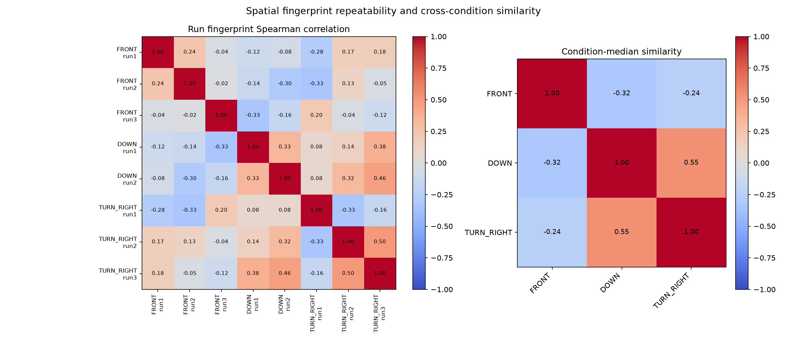

# Multi-Antenna Wi-Fi Respiration Sensing

**Zhihan Wang · University of Sydney**

## Project overview

This project investigates multi-antenna Wi-Fi respiration sensing using six
switched antenna states and three receive-chain pairs. It implements respiration
estimation and observation selection, and compares the results against a NeuLog
respiration belt. Across eight accepted static recordings, Max-BNR reduced mean
absolute error from **4.227 to 2.124 bpm** compared with the fixed observation,
a reduction of approximately **49.8%**.

The aim is to reduce dependence on a single observation that can perform poorly
in a particular recording. The results show useful alternative views, but also
selection failures: additional observations do not guarantee a reliable estimate.
A separate motion study explores how responses differ across the array.

## Method

The platform uses twelve switched antennas, three Intel 5300 receive chains,
PicoScenes CSI captures and a NeuLog respiration belt. The six states are G1,
G2, G3, G4, C1 and C2; each supplies Rx0/Rx1, Rx0/Rx2 and Rx1/Rx2 ratios.
This gives **18 sequential observations per recording**, not 18 simultaneous
independent sensors.

```text
CSI packets → state visits → same-packet complex Rx ratios → dwell medians
→ projection and BNR → selected subcarriers → combined ACF → respiration candidates
→ Fixed / Max-BNR / SQI selection → comparison with the belt-derived reference
```

The estimator adapts a local FarSense-style implementation. Fixed always uses
G1 Rx1/Rx2. Max-BNR selects by breathing-band signal quality. The adapted SQI
combines breathing-band power, agreement between two rate estimates, and spectral purity.
These three selectors use CSI only; the belt reference is joined afterwards
for evaluation. Oracle uses the reference to choose the lowest-error candidate
and is included only as a retrospective comparison.

## Main static results

The comparison contains eight accepted recordings and 144 observation outputs:
three 10 bpm, two 15 bpm and three 20 bpm recordings. The instructed rates are
experimental conditions, not physiological ground truth. Each recording has
equal weight in the following belt-referenced metrics.

| Method | MAE (bpm) | Median absolute error (bpm) | Largest observed error (bpm) |
| --- | ---: | ---: | ---: |
| Fixed G1 · Rx1/Rx2 | 4.227 | 3.724 | 9.767 |
| Max-BNR | 2.124 | 0.237 | 8.395 |
| Adapted SQI | 2.188 | 1.238 | 6.245 |
| Oracle, retrospective | 0.283 | 0.053 | 0.945 |

Max-BNR improves the average and median error over the fixed observation on
these recordings. SQI has mixed results: its largest error is lower than
Max-BNR's, but its mean and median errors are higher. Oracle shows that useful
candidates are often present even when automatic selection misses them.

The failed 15 bpm estimates remain in the comparison. The excluded 15 bpm run2
remains on reference-quality hold. All eight accepted recordings are from one
participant on the same day, so the 144 observations are not 144 independent
experiments. The table matches the final thesis, Table 4.2, and can be recalculated
from the bundled full-precision [static tables](results/static/).

## Motion analysis

The motion workflow detects CSI-change candidates and measures their amplitude
and differential-energy responses across the same 18 observations. Event features
are aggregated by their median within each run. The original robust normalization
and Spearman correlation then compare run fingerprints and condition medians.

| Motion condition | Recordings | Candidate events | Within-condition run-pair correlation, median (range) |
| --- | ---: | ---: | ---: |
| Forward movement | 3 | 10 | −0.020 (−0.043 to 0.240) |
| Downward movement | 2 | 4 | 0.329 (one pair) |
| Right turn | 3 | 8 | −0.163 (−0.334 to 0.497) |

Different observations respond differently, but the spatial patterns have limited
repeatability across runs. These findings support exploratory analysis of array
responses, not an action classifier or validated continuous-motion respiration
accuracy. The 22 events are CSI candidates without independently synchronized
action labels.

The [motion results](results/motion/) contain 144 run-observation fingerprints,
28 run-pair correlations, three condition-pair correlations and two figures.
The motion entry point regenerates these outputs from the private ratio archives.



## Installation and usage

Tested on macOS with **Python 3.12.1**, NumPy 2.2.6, SciPy 1.15.3 and
Matplotlib 3.11.2 in a separate virtual environment. No GPU or hardware
is needed for the public example and result-table evaluation.
Open a terminal in this `Zhihan_Wang` directory. Check that `python3 --version`
selects Python 3.12, then run:

```sh
python3 -m venv .venv
.venv/bin/python -m pip install -r requirements.txt
.venv/bin/python -B scripts/check_project.py
```

Run the small synthetic example:

```sh
.venv/bin/python -B scripts/analyze_static.py --synthetic examples/synthetic.json --out output/synthetic
```

This exercises the actual estimator and SQI with 18 generated ratio sequences
at 15 bpm. All 18 return 15 bpm; this is a software check, not measured performance.
The example's source and purpose are described in [examples/README.md](examples/README.md).

Recalculate the measured static comparison:

```sh
.venv/bin/python -B scripts/evaluate_selection.py --tables results/static --out output/measured
```

This reselects observations from saved CSI candidate and quality tables before
joining the reference, then checks the frozen metrics. It does not decode raw CSI.

Reprocess authorized private arrays:

```sh
.venv/bin/python -B scripts/analyze_static.py --waveforms /path/to/waveform_checkpoints --out output/static_replay
.venv/bin/python -B scripts/analyze_motion.py --archive /path/to/spatial_fingerprint --out output/motion
```

Always use a new output directory; existing directories are rejected to protect
inputs and previous results. On Windows, create the environment with
`py -3.12 -m venv .venv` and use `.venv\Scripts\python.exe`. Windows was not tested.

For the recovered raw-loader prototype, install the optional csiread dependency:

```sh
.venv/bin/python -m pip install -r requirements-csi.txt
.venv/bin/python -B scripts/analyze_static.py --run-dir /path/to/capture/run1 --out output/raw_static
.venv/bin/python -B scripts/analyze_motion.py --run-dir /path/to/capture/run1 --out output/raw_motion
```

Real final-run raw captures were unavailable for validation. These commands use
the recovered approximate host-span timing loader; they are not a verified
reconstruction of the final acquisition. No device-control command is provided.

## Data and outputs

The package contains the synthetic configuration, compact static and motion result
tables, motion figures and the supported source. It excludes raw CSI, belt
waveforms, private metadata, photographs and historical notebooks/scripts.

| Input | Format and units |
| --- | --- |
| Synthetic example | JSON: sampling rate in Hz, duration in seconds, imposed breaths/minute and seed |
| Static observation/quality tables | CSV keyed by dataset/run/state/pair; candidate and reference rates in bpm, BNR dimensionless, SQI in [0,1] |
| Private static checkpoints | NPZ: 18 complex `(N,30)` dwell-ratio arrays, times in seconds, sample rates in Hz and saved estimator assets |
| Private motion archive | `run_inventory.csv` and eight complex-ratio NPZ files; run-relative seconds and `(N,30)` observations |
| Raw run | One `.csi`, `events.log`, `metadata_qc.json`; motion also needs `run.json`; tensor layout `(packets,1 Tx,3 Rx,30 tones)` |

| Workflow | Main output files |
| --- | --- |
| Static analysis | `predictions.csv`, `quality.csv`, `diagnostic.png`; checkpoint replay also writes `regression.csv` |
| Selection evaluation | `run_comparison.csv`, `method_summary.csv`, `selection_error.png` |
| Motion events | `candidate_events.csv`, `event_observation_features.csv`, `candidate_timelines.png` |
| Motion fingerprints | `run_spatial_fingerprints.csv`, `run_pair_similarity.csv`, `action_similarity.csv`, `run_spatial_fingerprints.png`, `fingerprint_similarity.png` |

Each run also writes `summary.json`, configuration, input hashes, a code snapshot,
warnings and execution status. Output may contain local input paths and is ignored
by Git. Exact schemas and missing raw-input requirements are in
[REPRODUCTION.md](docs/REPRODUCTION.md); technical checks are summarized in
[VALIDATION.md](docs/VALIDATION.md).

## Known limitations

The static study is small and includes difficult recordings. Exact belt/CSI
interval correspondence, physical Rx mapping and raw timing are not independently
verified for every final run. The saved 15 bpm run1 reference has an unresolved
interval-matching limitation. Reference acceptance is not automated by this package.

The ACF estimator takes the first local maximum after the first local minimum;
it does not enforce a positive peak or a 6–30 bpm output range. SQI uses a separate
5–35 bpm band. Nonuniform dwell times use the original effective sample-rate
approximation, and the motion detector interpolates missing detection bins,
including long gaps. Run warnings identify these sampling and interpolation limits.

Matching Raspberry Pi GPIO/RF-switch control and collection source was not
located. Acquisition and hardware operation are therefore outside this release.
Full raw replay requires the original captures and supporting timing/reference
records. The available saved-array replay validates the implemented computations,
not the entire acquisition chain or general physiological accuracy.

## Contributions and third-party sources

Zhihan Wang's work covers the switched-array respiration adaptation, observation
comparison, experimental analysis and interpretation represented by this project.
FarSense supplies the respiration-estimation approach, VitalCSI motivates the
adapted SQI, and WiCAL is the prior switched-array platform. The local estimator
is not claimed to be the official FarSense implementation.

Full references and implementation provenance are in [SOURCES.md](docs/SOURCES.md).
The [source/name map](docs/NAME_MAP.md) identifies the original scripts from which
current modules were extracted. Third-party code retains its original attribution and licensing requirements.
